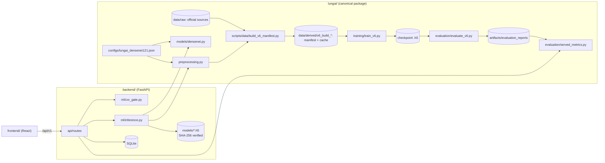

# LungAI — Six-Class Chest X-Ray Classification

LungAI is an M.Tech research project. It classifies a frontal chest X-ray into one of six classes and serves the result through a FastAPI backend and a React frontend.

> **Research prototype. Not a medical device and not clinically validated.** Its outputs are uncalibrated softmax scores, not diagnoses.

## The model

There is one model: **LungAI DenseNet-121 — Six-Class Chest X-Ray Classifier**.

| Field | Value |
|---|---|
| Model ID | `lungai-densenet121-6class` |
| Version and checkpoint | See [Results](#results) (generated). The checkpoint is **not in this repository**: see [Checkpoint availability](#checkpoint-availability) |
| Architecture | DenseNet-121 (ImageNet weights) → global average pooling → BatchNorm → Dense(256, ReLU) → Dropout(0.3) → Dense(6, softmax) |
| Task | Single-label, mutually exclusive six-class classification |
| Input | 224 × 224 × 3. Preprocessing: Gaussian blur (3×3, σ = 0.8), CLAHE on LAB L, Gaussian low-pass (σ = 1.0), Lanczos-4 resize, ImageNet normalisation |
| Definition | [`lungai/configs/lungai_densenet121.json`](lungai/configs/lungai_densenet121.json). This file is the only source of truth |

Why this model was chosen: [docs/model_card.md](docs/model_card.md#why-this-model).

### Classes and output order

| Index | ID | Class |
|---:|---|---|
| 0 | `covid19` | COVID-19 |
| 1 | `normal` | Normal |
| 2 | `pleural_effusion` | Pleural Effusion |
| 3 | `pneumonia` | Pneumonia |
| 4 | `nodule_mass` | Pulmonary Nodule / Mass |
| 5 | `tuberculosis` | Tuberculosis |

The backend loads this order from the config and returns it with every prediction (`class_order`). The frontend reads it from that response.

## Dataset (V6)

V6 is rebuilt from official sources (candidates: NIH ChestX-ray14, Kermany, Shenzhen, TBX11K, the Cohen COVID-19 collection, the COVID-19 Radiography Database; Montgomery as an external cohort only; the sources used by the current build are listed in [docs/results/current_model.md](docs/results/current_model.md#dataset-composition)) by [`scripts/data/build_v6_manifest.py`](scripts/data/build_v6_manifest.py) under rules fixed before training ([`lungai/configs/dataset_v6_proposal.json`](lungai/configs/dataset_v6_proposal.json), [proposal](docs/data/dataset_v6_proposal.md)):

- labels come from each source's own labels; multi-finding NIH images, TBX11K "sick but not TB" and latent-TB images are excluded;
- splits are 70/15/15 by patient group; groups are merged across exact and near-duplicate images, so no known patient and no duplicate crosses splits (rows without patient identity, TBX11K and the COVID-19 Radiography Database, are grouped per image, so their separation is by image only);
- development images that duplicate the external cohort are removed.

Images are **not** in the repository (licences do not allow it); download provenance (URL, bytes, SHA-256) is logged in `data/raw/_provenance/`. Per-class and per-source counts: [docs/results/current_model.md](docs/results/current_model.md#dataset-composition). Patient identity is unknown for some sources, which are then grouped per image; [docs/data/](docs/data/) explains each source.

## Results

<!-- BEGIN GENERATED: summary -->
_Generated by `python -m lungai.evaluation.render_docs` from `artifacts/evaluation_reports/model_metrics.json` (2026-11-03T23:25:06+00:00). Do not edit by hand._

**LungAI DenseNet-121 — Six-Class Chest X-Ray Classifier v6.1**, dataset V6 (`v6_build_002`), checkpoint `densenet121_v6r2_seed42.h5` (SHA-256 `7992b8da10ff…`).

| Split | N | Accuracy (95% CI) | Macro F1 | Macro ROC-AUC |
|---|---:|---:|---:|---:|
| Validation (checkpoint selection) | 2348 | 76.9% | 78.5% | 0.953 |
| Test (evaluated once) | 2350 | 77.4% (75.7–79.0%) | 78.8% | 0.955 |

External, Montgomery County (N=138, normal vs TB only, evaluated once): TB scans flagged abnormal 55/58 (94.8%, 95% CI 85.9–98.2%); normal scans called Normal 19/80 (23.8%, 95% CI 15.8–34.1%); TB scans called Tuberculosis 0/58 (0.0%, 95% CI 0.0–6.2%); ROC-AUC of P(abnormal) 0.809.

Evidence: REPRODUCED: computed by lungai.evaluation.evaluate_v6 from per-image predictions of this checkpoint (saved under artifacts/evaluation_reports/v6_r2_*). One training run (seed 42), CPU-only and time-boxed; run-to-run variation over further seeds of the same recipe and split is in artifacts/evaluation_reports/multi_seed_summary.json.

Previous model v5.0 (dataset V5, history only): internal test accuracy 82.9% (N=1570), external sensitivity 58/58 with specificity 0/80. Earlier model, kept for the record only. Its checkpoint is lost and its dataset (V5) had patient overlap between training and test; these numbers are not comparable with the current model's.
<!-- END GENERATED: summary -->

Full tables (training curve, per class, per source, confusion matrix, external breakdown): [docs/results/current_model.md](docs/results/current_model.md). What these numbers do and do not show: [docs/limitations.md](docs/limitations.md).

### History: the V5 model (superseded)

The previous model, v5.0, was trained on dataset V5 (10,547 images). Its checkpoint is lost, and V5 had defects: 154 of 1,570 internal-test images came from patients also in training, 1,395 Pneumonia labels were TBX11K "sick but not TB" images, and all COVID-19 images came from one source. Its recorded results (82.93% internal-test accuracy; on Montgomery 58/58 sensitivity with **0/80** specificity, i.e. every image called abnormal) are kept in [artifacts/evaluation_reports/historical_record_verification.md](artifacts/evaluation_reports/historical_record_verification.md) and are not comparable with V6. The figures 76.18% / 0.9600 that circulate in earlier drafts belong to a different V5-era run (the ERM baseline), not to either model.

## Architecture



Details: [docs/architecture.md](docs/architecture.md).

## Quick start

Prerequisites: Python 3.11 or 3.12 (TensorFlow 2.16.1 does not support 3.13), Node 18+, Git.

1. Install the backend dependencies:

   ```bash
   python -m venv .venv && . .venv/bin/activate   # Windows: .venv\Scripts\activate
   pip install -r backend/requirements.txt
   ```

2. Install the checkpoint (optional, but without it `/predict` returns 503):

   ```bash
   python scripts/install_checkpoint.py --from runs/<run-name>/model.h5   # file name and SHA-256 come from the config
   ```

3. Start the backend on http://127.0.0.1:8000 (docs at `/docs`):

   ```bash
   cd backend && python main.py
   ```

4. Start the frontend on http://localhost:3000. It proxies `/api` to port 8000.

   ```bash
   cd frontend && npm ci && npm start
   ```

Configuration is in [`backend/.env.example`](backend/.env.example). Docker: `docker build -t lungai .` then `docker run -p 8000:8000 -v /path/to/models:/app/models:ro lungai`. The image has not been built in this branch.

## Research pipeline

The canonical entry points for the V6 pipeline. Downloads go to `data/raw/` (gitignored).

```bash
python scripts/data/acquire.py <source> --execute       # official download, resumable, size-checked, provenance logged
python scripts/data/build_v6_manifest.py --raw-root data/raw --out data/derived/<build> --sources <ids...>
python -m lungai.training.train_v6 --build data/derived/<build> --run-name <run>   # selects on validation macro-F1
python -m lungai.evaluation.evaluate_v6 --build data/derived/<build> --checkpoint runs/<run>/model.h5 --split val --out artifacts/evaluation_reports/<prefix>_val
python -m lungai.evaluation.evaluate_v6 ... --split test --final       # once
python -m lungai.evaluation.evaluate_v6 ... --split external --final   # once
python -m lungai.evaluation.served_metrics --eval-prefix <prefix> --run runs/<run>   # what the API serves
python -m lungai.evaluation.render_docs                                 # regenerate the results blocks in the docs
```

`scripts/pipeline/run_overnight.py` chains these steps and can be restarted where it stopped. Training and evaluation stop with an error if any cached image is missing; they never skip or replace images silently. The V5 tools (`lungai.data.validate`, `lungai.training.train`, `lungai.evaluation.evaluate`, `lungai.evaluation.historical`) remain for the historical record.

## Testing

```bash
python -m pytest                                   # tests/ (research pipeline, data, consistency) + backend/tests
cd frontend && CI=true npx react-scripts test --watchAll=false
```

Tests that need the real checkpoint are skipped, with a reason, when it is absent. Results from this branch are in [docs/testing.md](docs/testing.md).

## Checkpoint availability

The trained checkpoint is not committed (`*.h5` is gitignored) and has no public release; it is produced by `train_v6` and installed locally with `scripts/install_checkpoint.py`. The backend loads only a file whose SHA-256 matches the config. Without it:

- `/api/v1/health` reports `degraded`.
- `/api/v1/predict` returns **503 `MODEL_NOT_LOADED`**.
- Nothing is written to the database.

There is no demo or fallback prediction.

## Repository layout

```text
lungai/            canonical package: config, preprocessing, data checks, model, training, evaluation
backend/           FastAPI service (api/, ml/ inference + CXR gate, database/, tests/)
frontend/          React app (src/pages, src/services)
data/manifests/    historical V5 manifest (V6 builds live in data/derived/, gitignored; images are external)
artifacts/         generated data-quality, validation and evaluation reports (model_metrics.json is what the API serves)
tests/             research-pipeline, data and repository-consistency tests
scripts/           install_checkpoint.py, data/ (download, build), pipeline/ (unattended run)
docs/              current documentation; docs/archive/ = historical drafts and audits
experiments/       HISTORICAL experiment scripts and results (not the canonical pipeline)
```

## Documentation

- System: [architecture](docs/architecture.md), [API](docs/api.md), [inference](docs/inference.md), [frontend](docs/frontend.md)
- Data: [dataset](docs/dataset.md), [data splits](docs/data_splits.md)
- Model: [model card](docs/model_card.md), [current results](docs/results/current_model.md), [training](docs/training.md), [evaluation](docs/evaluation.md), [experiment results](docs/experiment_results.md)
- Process: [reproducibility](docs/reproducibility.md), [testing](docs/testing.md), [deployment](docs/deployment.md), [troubleshooting](docs/troubleshooting.md)
- [Limitations](docs/limitations.md) and [thesis methodology](docs/thesis_methodology.md)
- Data recovery and V6: [source inventory](docs/data/dataset_source_inventory.md), [recovery plan](docs/data/data_recovery_plan.md), [V6 rules](docs/data/dataset_v6_proposal.md), [training plan](docs/data/training_plan_v6.md)

## Intended use

Intended for academic research and demonstration of a chest X-ray classification pipeline. Do not use it to diagnose, triage or treat anyone.
