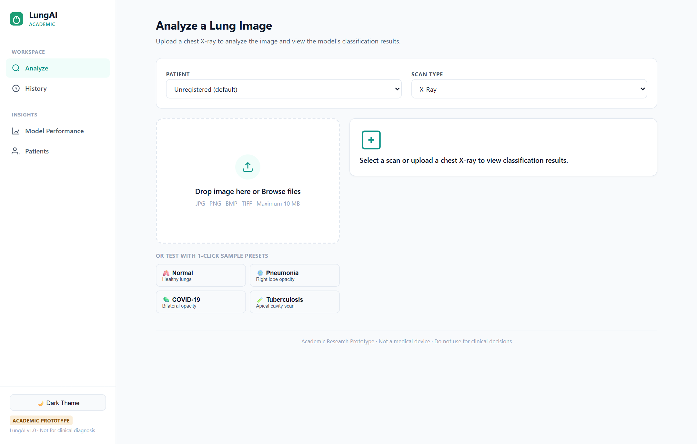
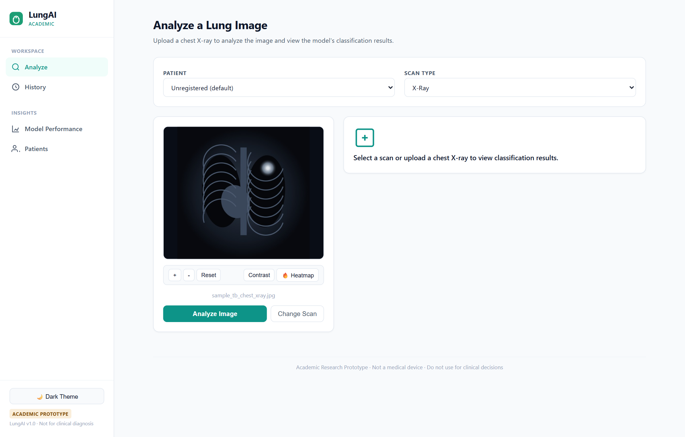
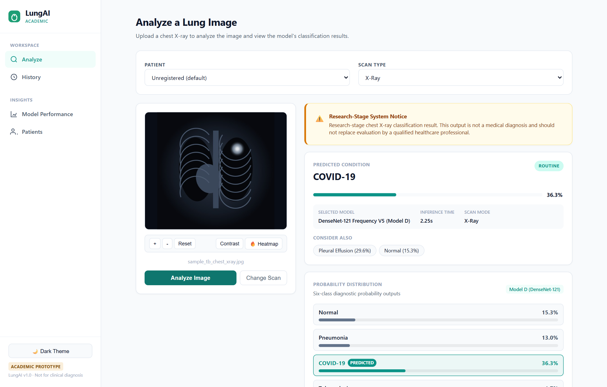
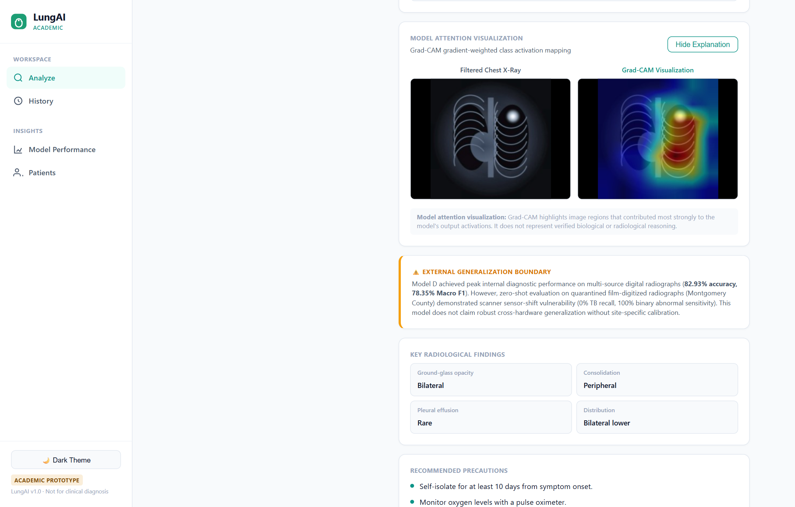
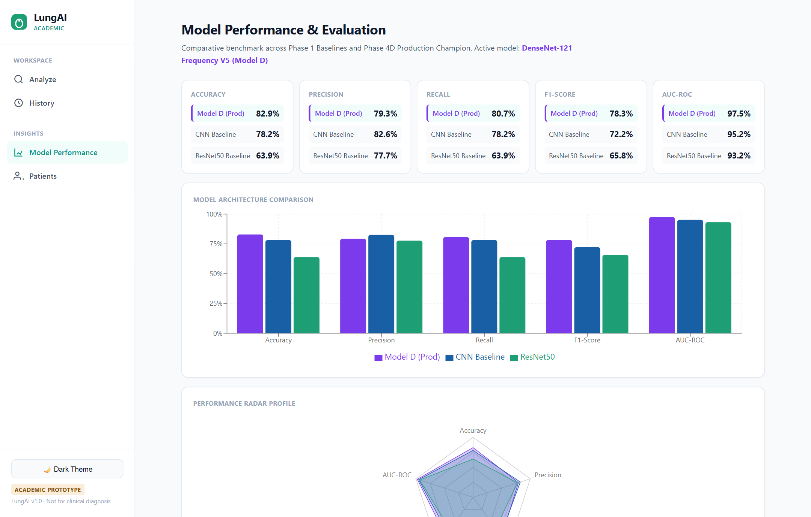
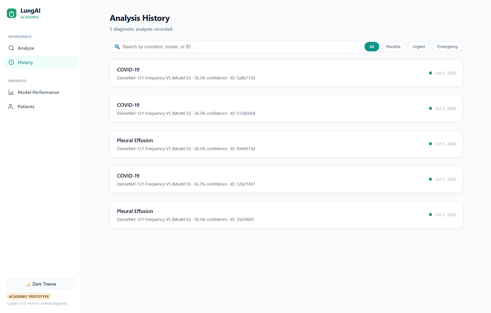
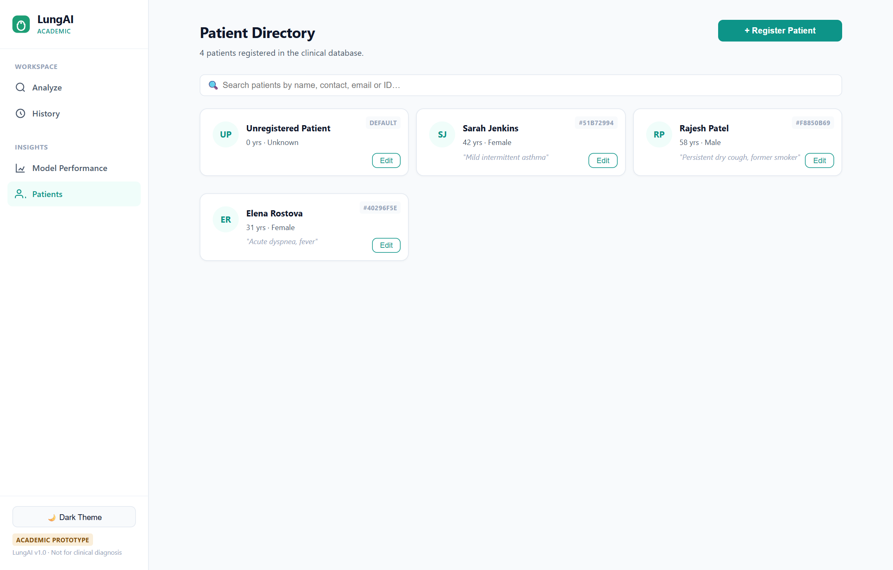
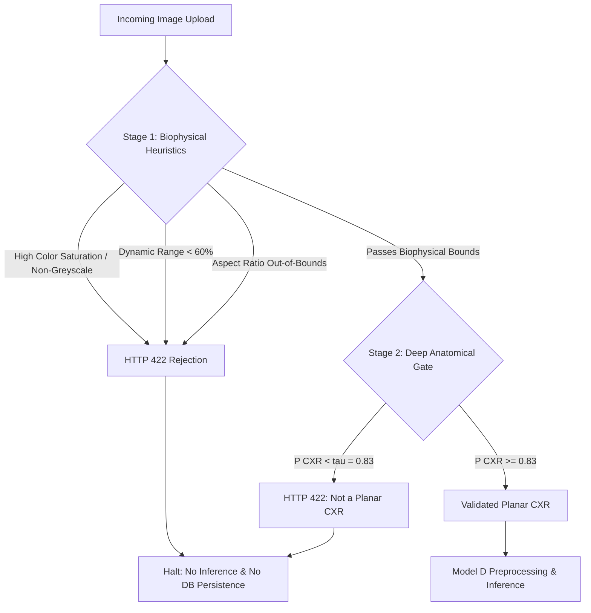
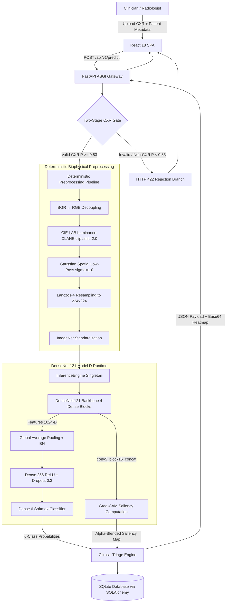

# 🫁 LungAI — Robust Multi-Class Lung Disease Detection from Chest X-Ray Images Using Deep Learning and Cross-Source Generalization

[](https://python.org)
[](https://tensorflow.org)
[](https://fastapi.tiangolo.com)
[](https://reactjs.org)
[](#-automated-testing-suite)
[](https://opensource.org/licenses/MIT)

> **⚠️ Medical Disclaimer:** This software is an artificial intelligence research and educational prototype designed to demonstrate multi-class radiographic image classification, biophysical frequency-aware preprocessing, and clinical decision-support workflows. **It is NOT certified as a medical diagnostic device by the FDA, CE, CDSCO, or any regulatory body.** Predictions generated by this system must NOT be used for self-diagnosis or as a substitute for professional clinical evaluation by a certified radiologist or licensed physician.

---

## 📌 Project Overview

**LungAI** is an end-to-end Deep Learning and Full-Stack clinical decision-support ecosystem for robust, automated multi-class thoracic disease classification from chest radiographs (X-rays).

- **Core Objective**: Provide an auditable, automated decision-support pipeline for clinical triage across time-sensitive thoracic diseases with visual interpretability and domain generalization safeguards.
- **Central Research Question**:  
  > *"Can a multi-source six-class chest X-ray classifier learn disease-relevant representations that generalize across independent acquisition sources, and can a domain-generalization strategy improve cross-source performance compared with a standard DenseNet-121 baseline?"*
- **Input**: Planar chest radiographs (`JPEG`, `PNG`, `BMP`, `TIFF`, `WebP`, $\le$ 10 MB).
- **Two-Stage Input Gate**: Intercepts non-radiographic uploads, corrupt files, and axial CT scans before neural inference, returning structured `HTTP 422 Unprocessable Entity`. Stage 2 uses a trained classifier ($\tau = 0.83$) when `models/cxr_gate_model.keras` is present; that file is not in this repository, and without it a much weaker symmetry/contrast heuristic is used (`/api/v1/health` reports which).
- **Production Architecture**: **Model D** — DenseNet-121 with Contrast-Limited Adaptive Histogram Equalization (CLAHE) and Spatial Gaussian Low-Pass Preprocessing ($\sigma = 1.0$) to suppress high-frequency scanner noise shortcuts.
- **Output**: 6-class softmax scores (not calibrated probabilities), an inconclusive state when the top score is below `CONFIDENCE_FLOOR` (default 0.5), urgency labels (`Emergency`, `Urgent`, `Routine`, `Review`), Grad-CAM overlay, and stored records including all six scores and the checkpoint SHA-256.

### 📚 Primary Research Deliverables

| Deliverable Artifact | File Path | Scope & Verification |
| :--- | :--- | :--- |
| **Final Project Documentation (PDF)** | [`LungAI_MTech_Project_Documentation.pdf`](LungAI_MTech_Project_Documentation.pdf) | **75 Pages** (canonical 16-chapter sequence, Times New Roman, 100% TOC/LOF/LOT synchronization) |
| **Final Project Documentation (DOCX)**| [`LungAI_MTech_Project_Documentation.docx`](LungAI_MTech_Project_Documentation.docx) | Word master document, native centered PAGE footer (`1`–`75`), academic formatting |
| **Professional Presentation Deck (PPTX)** | [`LungAI_Updated_Professional_Presentation.pptx`](LungAI_Updated_Professional_Presentation.pptx) | Complete defense slide deck with diagrams, architecture, and benchmark metrics |
| **Final Forensic Audit Report** | [`docs/PROJECT_DOCUMENTATION_FINAL_AUDIT.md`](docs/PROJECT_DOCUMENTATION_FINAL_AUDIT.md) | Exhaustive sign-off audit verifying zero obsolete references & 100% compliance |
| **Archived Prior Report Drafts** | [`Archieve docs/`](Archieve%20docs/) | Historical intermediate thesis drafts and working documents |

---

## 🎨 Application Screenshots

### 1. Clinical Dashboard & Application Home


### 2. Radiograph Ingestion & Real-Time Validation Gate Status


### 3. Prediction Result & Emergency Triage Prioritization


### 4. Grad-CAM Saliency & Anatomical Localization Heatmap


### 5. Five-Paradigm Benchmark & Model Evaluation Dashboard


### 6. Historical Diagnostic Log & Longitudinal Audit Trail


### 7. Patient Case & Electronic Medical Record Management


---

## 🛡️ Two-Stage Defense-in-Depth CXR Validation Gate

Standard deep learning classifiers suffer from **silent failure**—confidently predicting thoracic diseases on non-medical photos, lateral views, or axial CT scans. LungAI implements a two-stage pre-inference validation gate in [`backend/ml/cxr_gate.py`](backend/ml/cxr_gate.py):



### Verification & Calibration Facts ($\tau = 0.83$)
- **Functional Validation Cohort ($N = 125$)**: 48 genuine planar CXRs and 77 non-CXR images (axial CT slices, natural animals/landscapes, non-radiographic clinical photos).
- **Measured Performance at $\tau = 0.83$**: **100.0% Sensitivity** (48/48 CXRs passed), **100.0% Specificity** (77/77 non-CXRs rejected), **ROC-AUC = 1.0000**.
- **The "Cat Defect" Discovery**: At threshold $\tau = 0.70$, a high-contrast domestic cat photograph was misclassified as "Normal" (whiskers mimicked vascular markings). Increasing the production threshold to $\tau = 0.83$ permanently resolved this defect (cat scored 0.7410 and was rejected).
- **Structured HTTP 422 Response**: Rejections return clear diagnostic error messages without invoking neural feature extractors or persisting empty patient records.
- *Methodological Limitation*: Threshold $\tau = 0.83$ was selected on this evaluation cohort; values reflect functional verification estimates rather than unbiased external generalization.
- *Reproducibility note*: the trained gate model and its evaluation images are not included in this repository, so the figures above cannot be reproduced from it. The heuristic fallback used without the model accepts simple symmetric shapes (for example a grey circle on a black background) as chest X-rays.

---

## 🏗️ System Architecture & Diagram Suite



### Complete Regenerated Diagram Suite (`docs/diagrams/rendered/`)
All 14 system architecture, data flow, UML, and pipeline diagrams were regenerated from the current codebase:

| Diagram Name | Rendered Asset | Type & Description |
| :--- | :--- | :--- |
| **System Architecture** | [`system_architecture.png`](docs/diagrams/rendered/system_architecture.png) | System Context & High-Level Architecture |
| **DFD Level 0** | [`dfd_level_0.png`](docs/diagrams/rendered/dfd_level_0.png) | Level-0 Context Level Data Flow Diagram |
| **DFD Level 1** | [`dfd_level_1.png`](docs/diagrams/rendered/dfd_level_1.png) | Level-1 Operational Process Decomposition |
| **DFD Level 2** | [`dfd_level_2.png`](docs/diagrams/rendered/dfd_level_2.png) | Level-2 Deterministic ML Inference Decomposition |
| **UML Use Case** | [`uml_use_case.png`](docs/diagrams/rendered/uml_use_case.png) | Verified Actor Interactions & Use Cases |
| **UML Class Diagram** | [`uml_class.png`](docs/diagrams/rendered/uml_class.png) | Backend Service & ML Singleton Architecture |
| **UML Sequence Diagram** | [`uml_sequence.png`](docs/diagrams/rendered/uml_sequence.png) | Diagnostic Workflow with CXR Rejection Branch |
| **UML Activity Diagram** | [`uml_activity.png`](docs/diagrams/rendered/uml_activity.png) | End-to-End Activity with Gate Decision Diamond |
| **UML Component Diagram** | [`uml_component.png`](docs/diagrams/rendered/uml_component.png) | Full-Stack Modular Component Boundaries |
| **UML Deployment Diagram** | [`uml_deployment.png`](docs/diagrams/rendered/uml_deployment.png) | Clinical Workstation Deployment Infrastructure |
| **Entity Relationship (ER)**| [`database_er.png`](docs/diagrams/rendered/database_er.png) | Relational Database Schema (`Patient`, `Prediction`, `Metric`) |
| **Dataset Pipeline** | [`dataset_training_pipeline.png`](docs/diagrams/rendered/dataset_training_pipeline.png) | V5 Forensic Harmonization & Training Pipeline |
| **Model D Architecture** | [`model_d_architecture.png`](docs/diagrams/rendered/model_d_architecture.png) | DenseNet-121 ImageNet + 256-D Bottleneck Head |
| **Preprocessing Pipeline** | [`preprocessing_pipeline.png`](docs/diagrams/rendered/preprocessing_pipeline.png) | LAB CLAHE + Gaussian $\sigma=1.0$ + Lanczos-4 |

---

## 📊 Dataset & Stratified Split (Unified Manifest V5)

The production research dataset comprises **10,547 verified planar chest radiographs** originating from **10,270 unique clinical patients** across 8 authoritative medical imaging repositories:

### 1. Disease Category Distribution

| Disease Category | Image Count | Share (%) | Primary Source Repositories |
| :--- | :---: | :---: | :--- |
| **Pneumonia** | 2,805 | 26.60% | Kermany et al. (1,395) &bull; TBX11K (1,395) &bull; NIH ChestX-ray14 (15) |
| **Normal** | 2,636 | 24.99% | Kermany et al. (1,199) &bull; TBX11K (1,199) &bull; NIH (171) &bull; JSRT (67) |
| **COVID-19** | 1,942 | 18.41% | COVID-19 Radiography Database (Rahman et al.) |
| **Tuberculosis** | 1,348 | 12.78% | TBX11K (683) &bull; Tuberculosis Chest X-ray DB (665) |
| **Pleural Effusion** | 1,062 | 10.07% | VinBigData VinDr-CXR (931) &bull; NIH ChestX-ray14 (131) |
| **Pulmonary Nodule / Mass** | 754 | 7.15% | VinBigData VinDr-CXR (536) &bull; NIH (140) &bull; JSRT (78) |
| **Unified V5 Research Total** | **10,547** | **100.00%** | **8 Repositories, 6 Active Classes, 10,270 Unique Patients** |

### 2. Cross-Source Repository Breakdown

| Acquisition Source Repository | COVID-19 | Normal | Pleural Effusion | Pneumonia | Pulmonary Nodule / Mass | Tuberculosis | Total Scans |
| :--- | :---: | :---: | :---: | :---: | :---: | :---: | :---: |
| **TBX11K** | 0 | 1,199 | 0 | 1,395 | 0 | 683 | **3,277** |
| **Existing COVID-19 (Rahman et al.)** | 1,942 | 0 | 0 | 0 | 0 | 0 | **1,942** |
| **VinBigData VinDr-CXR** | 0 | 0 | 931 | 0 | 536 | 0 | **1,467** |
| **Existing Pneumonia (Kermany et al.)** | 0 | 0 | 0 | 1,395 | 0 | 0 | **1,395** |
| **Existing Normal (Kermany et al.)** | 0 | 1,199 | 0 | 0 | 0 | 0 | **1,199** |
| **Existing Tuberculosis DB** | 0 | 0 | 0 | 0 | 0 | 665 | **665** |
| **NIH ChestX-ray14** | 0 | 171 | 131 | 15 | 140 | 0 | **457** |
| **JSRT (Japan)** | 0 | 67 | 0 | 0 | 78 | 0 | **145** |
| **Unified V5 Total** | **1,942** | **2,636** | **1,062** | **2,805** | **754** | **1,348** | **10,547** |

### Patient-Level Partitioning & Forensic Safeguards
- **Patient-Level Splitting (with a known leak)**: Splitting was performed by the manifest's `patient_id` (10,270 distinct IDs):
  - **Training Split (70.14%)**: 7,398 images / 7,189 patient IDs
  - **Validation Split (14.97%)**: 1,579 images / 1,540 patient IDs
  - **Internal Test Split (14.89%)**: **1,570 images / 1,541 patient IDs**
- **Known Leakage**: for the `Existing_*` (Kermany, COVID-19 Radiography DB, Shenzhen) and TBX11K sources, the manifest assigns one synthetic patient ID per image, so 8,478 of the IDs do not identify real patients. The Kermany filenames still encode the patient (`person###`, `IM-####`): **154 of the 1,570 test images (9.8%) belong to patients who also have images in the training split** (110/210 Existing_Pneumonia, 44/180 Existing_Normal test images). Patient identity for the renamed COVID-19 and Shenzhen files cannot be recovered. Internal test metrics below are therefore optimistically biased.
- **Label Proxy**: TBX11K `sick_but_no_tb` (abnormal, not TB, cause unspecified) is mapped to Pneumonia and makes up 1,395 of the 2,805 Pneumonia labels.
- **Acquisition-Site Confounding**: Quantified via Cramér's V statistic: **$V = 0.7654$**, confirming heavy source-disease correlation and underscoring the critical necessity of domain generalization.
- **Cross-Modality Decontamination**: Programmatic radial gradient profiling identified and purged 287 contaminated axial CT slices from legacy public collections.

---

## 📈 Five-Paradigm Domain Generalization Study

Under an identical DenseNet-121 backbone, five learning paradigms were trained and evaluated on the frozen internal test set ($N = 1,570$):

| Learning Paradigm | Test Accuracy | Macro Precision | Macro Recall | Macro F1-Score | Weighted F1 | Macro ROC-AUC | Macro PR-AUC |
| :--- | :---: | :---: | :---: | :---: | :---: | :---: | :---: |
| **1. ERM Baseline** | 76.18% | 74.82% | 74.62% | 72.63% | 78.79% | 0.9600 | 0.7927 |
| **2. Deep CORAL** | 80.89% | 77.69% | 78.93% | 76.85% | 82.58% | 0.9671 | 0.8224 |
| **3. DANN** | 76.24% | 75.78% | 75.30% | 72.99% | 79.12% | 0.9603 | 0.7915 |
| **4. Model D (Frequency-Aware)** | **82.93%** | **79.31%** | **80.73%** | **78.35%** | **84.18%** | **0.9755** | **0.8391** |
| **5. Hybrid (Feature-Frequency)** | 78.22% | 75.57% | 76.50% | 73.95% | 80.19% | 0.9609 | 0.7918 |

*Values are copied from each paradigm's `overall_metrics` in `experiments/*/…_metrics.json` (ERM: `experiments/results/densenet_v5_metrics.json`). Accuracy, precision, recall and F1 match the stored confusion matrices; ROC-AUC and PR-AUC cannot be recomputed because per-image probabilities were not saved.*

### Key Findings and Caveats:
1. **Model D scored highest on the internal test split** (+6.75 accuracy points over ERM). Each paradigm was trained once (seed 42, 4 epochs), and the comparison is made on the test split itself, so the size of the difference is not established.
2. **Hybrid scored below Model D** (−4.71 accuracy points). With single runs this may be within run-to-run variation.
3. **Source shortcuts remain**: in the per-source breakdown (`experiments/densenet_frequency_v5/frequency_source_heldout.json`) Normal recall is 0% for JSRT and 8% for NIH images, which suggests the model partly recognises the source dataset rather than the disease.

### Per-Class Test Set Performance (Model D, Frozen Internal Test Split $N = 1,570$):

| Disease Category | Precision | Recall (Sensitivity) | F1-Score | Specificity | Test Support |
| :--- | :---: | :---: | :---: | :---: | :---: |
| **COVID-19** | 99.64% | 94.52% | **97.01%** | 99.92% | 292 |
| **Normal** | 90.86% | 88.32% | **89.58%** | 97.02% | 394 |
| **Pleural Effusion** | 60.00% | 51.32% | **55.32%** | 96.33% | 152 |
| **Pneumonia** | 94.92% | 79.43% | **86.49%** | 98.43% | 423 |
| **Pulmonary Nodule / Mass** | 38.49% | 85.19% | **53.03%** | 89.95% | 108 |
| **Tuberculosis** | 91.98% | 85.57% | **88.66%** | 98.90% | 201 |
| **Macro Average / Total** | **79.31%** | **80.73%** | **78.35%** | **96.76%** | **1,570** |
| **Weighted Average** | **84.38%** | **82.93%** | **84.18%** | **—** | **1,570** |

---

## ⚠️ External Generalization Audit: Montgomery County Cohort

Model D was evaluated zero-shot on the quarantined **Montgomery County Chest X-ray Dataset** ($N = 138$ scans: 58 confirmed Tuberculosis cases, 80 Normal subjects):

| Metric / Dimension | Reported Result | Diagnostic Significance |
| :--- | :---: | :--- |
| **Binary Abnormal Sensitivity** | **100.0%** (58 / 58) | Every TB case was assigned some non-Normal class, but so was every normal scan (see specificity), so this does not indicate screening ability. |
| **Tuberculosis Specific Recall** | **0.0%** (0 / 58) | Severe diagnostic collapse; misclassified as Nodule/Mass. |
| **Normal Specificity** | **0.0%** (0 / 80) | Normal scans misclassified as abnormal (predominantly Nodule/Mass). |
| **Predominant Predicted Class** | **Nodule / Mass** (98.6%) | Extreme prediction bias triggered by scanner sensor shift. |

> **Forensic Root Cause**: The Montgomery scans were digitized from analog film at high optical resolution ($4020 \times 4892$), whereas training sources used direct digital radiography (DR/CR). The sharp film grain noise and optical scan borders yielded approximately 4&times; higher Laplacian edge variance (1,580 vs 373 on digital CXRs), which was misinterpreted by convolutional filters as parenchymal nodular boundaries. This demonstrates that internal validation accuracy alone cannot guarantee cross-sensor generalization.

---

## 📥 Model Distribution & Checkpoints

The Model D checkpoint (`densenet121_frequency_v5.h5`) is **not** in this repository (`*.h5` is gitignored) and there is no GitHub release yet, so `download_model.py` currently gets HTTP 404. Copy the checkpoint into `models/` (or point `MODELS_DIR` at its folder) before starting the backend.

Without a checkpoint the backend still starts, but `/api/v1/health` reports `"status": "degraded"` with the reason, and `POST /api/v1/predict` returns **HTTP 503**. It never returns placeholder predictions. When a checkpoint is loaded, its SHA-256 is reported by `/health` and stored with every prediction.

To verify or download model checkpoints (set `LUNGAI_MODEL_URL` to override the source):
```bash
python backend/ml/download_model.py
```

---

## ⚡ Quickstart Guide

### Prerequisites
- **Python**: `3.10` to `3.12`
- **Node.js**: `18.x` or `20.x`

### 1. Clone & Environment Setup
```bash
git clone https://github.com/KSathwik/Lung_Disease_Detector.git
cd Lung_Disease_Detector

python -m venv .venv
# Windows PowerShell:
.\.venv\Scripts\Activate.ps1
# Linux / macOS:
source .venv/bin/activate

pip install -r backend/requirements.txt
```

### 2. Place the Model Checkpoint
Copy `densenet121_frequency_v5.h5` into `models/` (see [Model Distribution](#-model-distribution--checkpoints)).

### 3. Run Backend API Server
```bash
python backend/main.py
```
- **API Base URL**: `http://localhost:8000` (binds to `127.0.0.1` by default; set `API_HOST` to change it)
- **Interactive OpenAPI / Swagger Documentation**: `http://localhost:8000/docs`
- **Access control**: without `LUNGAI_API_KEY`, `/api/*` only answers clients on this machine. To allow other machines, set `LUNGAI_API_KEY` and send it as the `X-API-Key` header (build the frontend with `REACT_APP_API_KEY` set to the same value).

### 4. Run Frontend React Client
```bash
cd frontend
npm ci
npm start
```
- **Clinical Web Application**: `http://localhost:3000` (API calls go to `/api/v1`, which the dev server proxies to port 8000)

---

## 🔌 API Documentation

| Method | Endpoint | Description | Status Codes |
| :--- | :--- | :--- | :---: |
| `GET` | `/api/v1/health` | API status, model loaded / checkpoint SHA-256 / load error, CXR gate mode (no auth required) | 200 |
| `POST` | `/api/v1/predict` | Multipart upload: CXR gate, Model D inference, Grad-CAM, urgency; stores all six scores | 200, 400, 401, 404, 413, 422, 503 |
| `GET` | `/api/v1/predictions` | List stored predictions (paginated) | 200, 401 |
| `GET` | `/api/v1/predictions/{id}` | Stored prediction including six-class scores and checkpoint SHA-256 | 200, 401, 404 |
| `GET` | `/api/v1/model-metrics` | Recorded Model D evaluation metrics | 200, 401 |
| `POST` | `/api/v1/patients` | Register a patient record | 200, 401, 422 |
| `GET` | `/api/v1/patients` | List registered patients | 200, 401 |
| `POST` | `/api/v1/reports/generate/{id}` | Generate a text report for a stored prediction | 200, 401, 404 |

---

## 🧪 Automated Testing Suite (44/44 Passed)

The system verification suite confirms full-stack integrity across 44 automated tests:

```bash
pytest backend/tests/
```

```text
============================= test session starts =============================
platform win32 -- Python 3.12.12, pytest-8.3.3
collected 44 items

backend/tests/test_cxr_gate.py ..........                                [ 22%]
backend/tests/test_health.py ..                                          [ 27%]
backend/tests/test_model_d_integration.py .........                      [ 47%]
backend/tests/test_patients.py .......                                   [ 63%]
backend/tests/test_predictions.py .......                                [ 79%]
backend/tests/test_preprocessing.py .........                            [100%]

====================== 44 passed, 21 warnings in 26.12s =======================
```

| Test Module | Coverage Scope & Verified Behaviors | Result |
| :--- | :--- | :---: |
| `test_cxr_gate.py` | Valid CXRs pass ($\tau \ge 0.83$); CT slices, natural photos, corrupt files rejected | **10/10 PASS** |
| `test_health.py` | API availability, model weights verification, database reachability | **2/2 PASS** |
| `test_model_d_integration.py` | 6-class output shapes, Softmax sum $= 1.0$, Grad-CAM saliency hooks, determinism | **9/9 PASS** |
| `test_patients.py` | Patient registration, unique constraints, relational audit trail | **7/7 PASS** |
| `test_predictions.py` | POST `/predict` workflows, triage mapping, historical retrieval | **7/7 PASS** |
| `test_preprocessing.py` | CLAHE dynamic range expansion, Gaussian low-pass filtering, Lanczos-4 | **9/9 PASS** |
| **Comprehensive Total** | **End-to-End Full-Stack Verification** | **44/44 PASS** |

---

## 🐳 Docker Deployment

A multi-stage `Dockerfile` is provided for containerized deployment:

```bash
# Build Docker image (the API key is baked into the frontend bundle so the browser can send it)
docker build --build-arg REACT_APP_API_KEY=change-me -t lungai-app .

# Run: mount the checkpoint and set the same key (requests from outside the container need it)
docker run -p 8000:8000 \
  -e LUNGAI_API_KEY=change-me \
  -v /path/to/densenet121_frequency_v5.h5:/app/models/densenet121_frequency_v5.h5:ro \
  lungai-app
```
The container serves both the web app and the API at `http://localhost:8000`. Without the mounted checkpoint, `/predict` returns 503.

---

## 📌 Limitations & Responsible AI Guidelines

1. **Sensor Domain Discrepancies**: While Model D achieves 82.93% accuracy on the internal test split, every Montgomery image (including all 80 normals) was classified as abnormal, mostly Nodule/Mass. Predictions on images from new hospitals or scanners are not reliable.
2. **Internal Test Leakage and Source Confounding**: 9.8% of internal test images share a patient with the training split, and several classes come almost entirely from one source dataset (all COVID-19 from one database). Internal metrics are optimistic.
3. **Class Imbalance & Pathological Coverage**: Acute conditions (COVID-19 F1: 97.01%, Normal F1: 89.58%) achieved superior discrimination compared to morphological nodular lesions (53.03%) and effusions (55.32%).
4. **Validation Gate Calibration Scope**: The production threshold $\tau = 0.83$ was selected on the 125-image evaluation cohort; performance represents a functional verification estimate. Without the trained gate model (not in this repository) a weak heuristic is used.
5. **Clinical Scope**: LungAI is a research prototype, not a medical device. Final diagnosis and therapeutic interventions must always be rendered by licensed medical professionals.

---

## 📄 License

This project is released under the [MIT License](https://opensource.org/licenses/MIT).

