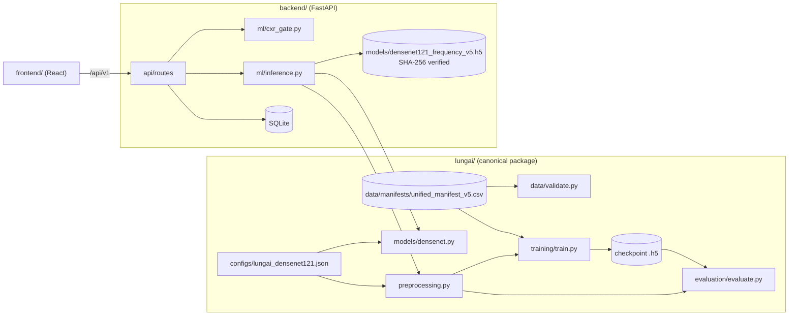

# LungAI — Six-Class Chest X-Ray Classification

LungAI is an M.Tech research project. It classifies a frontal chest X-ray into one of six classes and serves the result through a FastAPI backend and a React frontend.

> **Research prototype. Not a medical device and not clinically validated.** Its outputs are uncalibrated softmax scores, not diagnoses.

## The model

There is one model: **LungAI DenseNet-121 — Six-Class Chest X-Ray Classifier**.

| Field | Value |
|---|---|
| Model ID | `lungai-densenet121-6class` |
| Version | `v5.0` |
| Architecture | DenseNet-121 (ImageNet weights) → global average pooling → BatchNorm → Dense(256, ReLU) → Dropout(0.3) → Dense(6, softmax) |
| Task | Single-label, mutually exclusive six-class classification |
| Input | 224 × 224 × 3. Preprocessing: Gaussian blur (3×3, σ = 0.8), CLAHE on LAB L, Gaussian low-pass (σ = 1.0), Lanczos-4 resize, ImageNet normalisation |
| Checkpoint | `densenet121_frequency_v5.h5`, SHA-256 `e2c95dc5…889022`. **Not in this repository.** See [Checkpoint availability](#checkpoint-availability) |
| Definition | [`lungai/configs/lungai_densenet121.json`](lungai/configs/lungai_densenet121.json). This file is the only source of truth |

Why this model was chosen: [docs/model_card.md](docs/model_card.md#why-this-model).

### Classes and output order

| Index | ID | Class |
|---:|---|---|
| 0 | `covid19` | COVID-19 |
| 1 | `normal` | Normal |
| 2 | `pleural_effusion` | Pleural Effusion |
| 3 | `pneumonia` | Pneumonia |
| 4 | `nodule_mass` | Pulmonary Nodule / Mass |
| 5 | `tuberculosis` | Tuberculosis |

The backend loads this order from the config and returns it with every prediction (`class_order`). The frontend reads it from that response.

## Dataset (V5)

Manifest: [`data/manifests/unified_manifest_v5.csv`](data/manifests/unified_manifest_v5.csv). SHA-256 (LF line endings): `8117a441…702e26`. Images are **not** in the repository. All counts below come from the manifest and are produced by `python -m lungai.data.validate` ([report](artifacts/data_validation/data_validation_report.md)).

| Partition | Purpose | Images | Manifest patient IDs | Derived patient groups¹ | Permitted use |
|---|---|---:|---:|---:|---|
| Training | Learn model parameters | 7,398 | 7,189 | 6,722 | Gradient updates |
| Validation | Select settings and checkpoints | 1,579 | 1,540 | 1,513 | Model selection |
| Internal test | Final internal evaluation | 1,570 | 1,541 | 1,521 | Report once; never tune |
| **Total** | | **10,547** | **10,270** | **9,432** | |
| External: Montgomery County | Independent external assessment (binary TB vs normal) | 138² (58 TB, 80 normal) | — | — | External generalisation only |

¹ 8,478 rows carry a synthetic one-per-image patient ID, so "10,270 patients" counts ID strings, not people. Derived groups recover real patients where the filename allows (Kermany paediatric images).
² Taken from the recorded evaluation file. The Montgomery images and metadata are not in the repository, so this count has not been checked against files.

**Known data defects.** Each is detected by the validation report; details in [docs/data_splits.md](docs/data_splits.md).

- **Patient leakage:** 154 of 1,570 internal-test images (9.8%) come from patients who also have training images (Kermany Pneumonia 110, Kermany Normal 44).
- **Proxy labels:** 1,395 Pneumonia labels (49.7% of the class) are TBX11K "sick but not TB" images.
- **Single-source class:** every COVID-19 image comes from one source.

## Results (recorded; not reproducible from this repository)

These are aggregate results from the training run that produced the checkpoint. Threshold metrics were **recomputed from the stored confusion matrix and match** (29 of 29 checks). They cannot be reproduced here because no checkpoint, image or per-image prediction is in the repository. Source: [artifacts/evaluation_reports/historical_record_verification.md](artifacts/evaluation_reports/historical_record_verification.md).

| Split | Metric | Value |
|---|---|---|
| Internal test (N = 1,570, leaked, see above) | Accuracy | 82.93% (95% CI 80.99–84.71%) |
| | Macro F1 / weighted F1 | 78.35% / 84.18% |
| | Macro ROC-AUC (OvR) | 0.9755. Recorded, **unverifiable** (no saved probabilities) |
| External: Montgomery (binary) | Sensitivity (predicted ≠ Normal among TB) | 58/58 (95% CI 93.8–100%) |
| | Specificity (predicted Normal among normal) | **0/80** (95% CI 0–4.6%) |
| | TB scans classified as Tuberculosis | 0/58 |

On the external cohort the model called **every** image abnormal, so the 58/58 figure carries no screening value. Two figures that circulate in earlier drafts belong to a different run, the historical ERM baseline: **76.18% accuracy and 0.9600 macro ROC-AUC**. That run is not this model.

## Architecture



Details: [docs/architecture.md](docs/architecture.md).

## Quick start

Prerequisites: Python 3.11 or 3.12 (TensorFlow 2.16.1 does not support 3.13), Node 18+, Git.

1. Install the backend dependencies:

   ```bash
   python -m venv .venv && . .venv/bin/activate   # Windows: .venv\Scripts\activate
   pip install -r backend/requirements.txt
   ```

2. Install the checkpoint (optional, but without it `/predict` returns 503):

   ```bash
   python scripts/install_checkpoint.py --from /path/to/densenet121_frequency_v5.h5
   ```

3. Start the backend on http://127.0.0.1:8000 (docs at `/docs`):

   ```bash
   cd backend && python main.py
   ```

4. Start the frontend on http://localhost:3000. It proxies `/api` to port 8000.

   ```bash
   cd frontend && npm ci && npm start
   ```

Configuration is in [`backend/.env.example`](backend/.env.example). Docker: `docker build -t lungai .` then `docker run -p 8000:8000 -v /path/to/densenet121_frequency_v5.h5:/app/models/densenet121_frequency_v5.h5:ro lungai`. The image has not been built in this branch.

## Research pipeline

The following commands are the canonical entry points for data checks, training and evaluation. They need the images under `LUNGAI_DATA_ROOT` (the folder that contains `data/raw` and `data/downloads`).

```bash
python -m lungai.data.validate                     # dataset integrity report -> artifacts/data_validation/
python -m lungai.evaluation.historical             # verify recorded results -> artifacts/evaluation_reports/
python -m lungai.training.train --dry-run          # check config, manifest and every train/val image
python -m lungai.training.train --run-name <name>  # train; selects the checkpoint on validation macro-F1
python -m lungai.evaluation.evaluate --split val --checkpoint models/densenet121_frequency_v5.h5
python -m lungai.evaluation.evaluate --split test --checkpoint models/densenet121_frequency_v5.h5 --final
python -m lungai.evaluation.evaluate --split external --checkpoint models/densenet121_frequency_v5.h5 --final
```

Training and evaluation stop with an error if any image is missing. They never skip images or replace them silently.

## Testing

```bash
python -m pytest                                   # tests/ (research pipeline, data, consistency) + backend/tests
cd frontend && CI=true npx react-scripts test --watchAll=false
```

Tests that need the real checkpoint are skipped, with a reason, when it is absent. Results from this branch are in [docs/testing.md](docs/testing.md).

## Checkpoint availability

The trained checkpoint was never committed (`*.h5` is gitignored) and has no public release. The backend loads only a file whose SHA-256 matches the config. Without it:

- `/api/v1/health` reports `degraded`.
- `/api/v1/predict` returns **503 `MODEL_NOT_LOADED`**.
- Nothing is written to the database.

There is no demo or fallback prediction.

## Repository layout

```text
lungai/            canonical package: config, preprocessing, data checks, model, training, evaluation
backend/           FastAPI service (api/, ml/ inference + CXR gate, database/, tests/)
frontend/          React app (src/pages, src/services)
data/manifests/    canonical V5 manifest (images are external)
artifacts/         generated data-validation and evaluation reports
tests/             research-pipeline, data and repository-consistency tests
scripts/           install_checkpoint.py
docs/              current documentation; docs/archive/ = historical drafts and audits
experiments/       HISTORICAL experiment scripts and results (not the canonical pipeline)
```

## Documentation

- System: [architecture](docs/architecture.md), [API](docs/api.md), [inference](docs/inference.md), [frontend](docs/frontend.md)
- Data: [dataset](docs/dataset.md), [data splits](docs/data_splits.md)
- Model: [model card](docs/model_card.md), [training](docs/training.md), [evaluation](docs/evaluation.md), [experiment results](docs/experiment_results.md)
- Process: [reproducibility](docs/reproducibility.md), [testing](docs/testing.md), [troubleshooting](docs/troubleshooting.md)
- [Limitations](docs/limitations.md) and [thesis methodology](docs/thesis_methodology.md)

## Intended use

Intended for academic research and demonstration of a chest X-ray classification pipeline. Do not use it to diagnose, triage or treat anyone.
