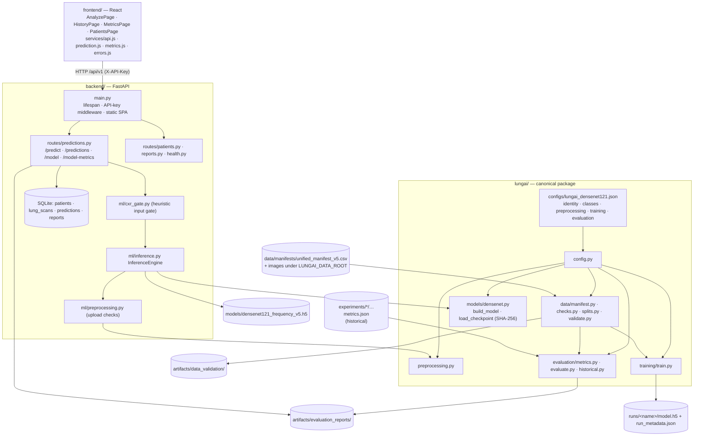

# Architecture

## Data to prediction

| Stage | Implementation |
|---|---|
| Dataset definition | `data/manifests/unified_manifest_v5.csv`, with its checksum checked by `lungai.data.manifest.load_manifest` |
| Data validation | `lungai.data.validate` → `artifacts/data_validation/` |
| Splitting | V5 split preserved as recorded. `lungai.data.splits.grouped_stratified_split` is for the next version |
| Preprocessing | `lungai.preprocessing` (one implementation) |
| Training | `lungai.training.train` (train and val only) |
| Checkpoint selection | Best validation macro-F1 (`training.checkpoint_selection`) |
| Evaluation | `lungai.evaluation.evaluate` (val, or test/external with `--final`) |
| Inference API | `backend/ml/inference.py` → `lungai.preprocessing` + `lungai.models.densenet.load_checkpoint` |
| Frontend | `frontend/src/pages/AnalyzePage.js` → `services/prediction.js` (class order and scores read from the response) |

## Endpoint → service → model

| Endpoint | Service | Model / data used |
|---|---|---|
| `POST /api/v1/predict` | `CXRGate.validate` → `InferenceEngine.predict` | Canonical checkpoint (SHA-256 checked), `lungai.preprocessing`, class order from config. 503 if not loaded |
| `GET /api/v1/model` | `InferenceEngine.identity()` | Config identity + load status |
| `GET /api/v1/model-metrics` | `predictions.get_model_metrics` | `artifacts/evaluation_reports/historical_record_verification.json` (canonical entry) |
| `GET /api/v1/health` | `InferenceEngine.status()`, `CXRGate.mode` | — |
| `GET /api/v1/predictions[/{id}]` | SQLAlchemy | Stored probabilities, model ID/version, checkpoint SHA-256 |
| `POST /api/v1/reports/generate/{id}` | `reports.py` | Stored prediction |
| `/api/v1/patients*` | `patients.py` | Patient records |

## Dependency direction

`backend` imports `lungai`. `lungai` never imports `backend`. `experiments/` is historical, and nothing active imports it.
